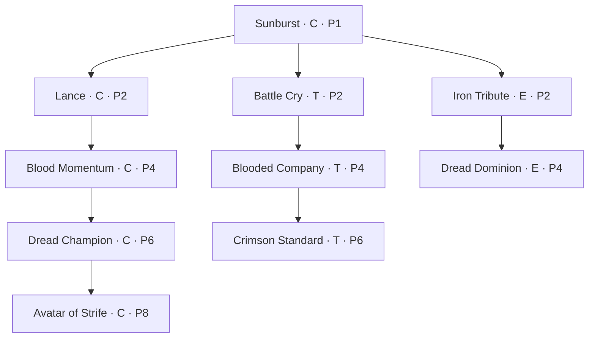
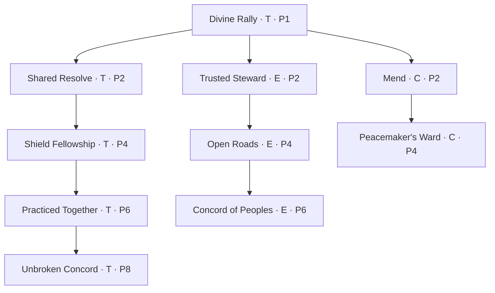
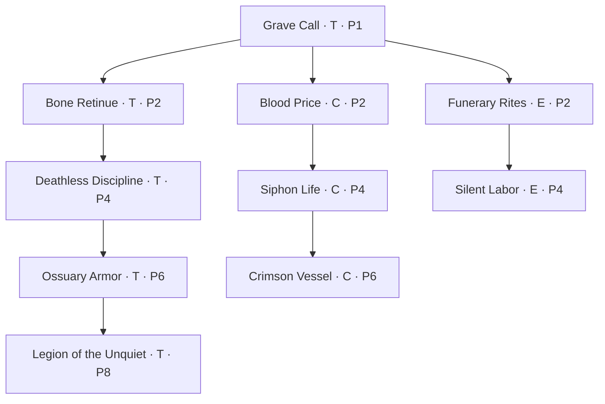
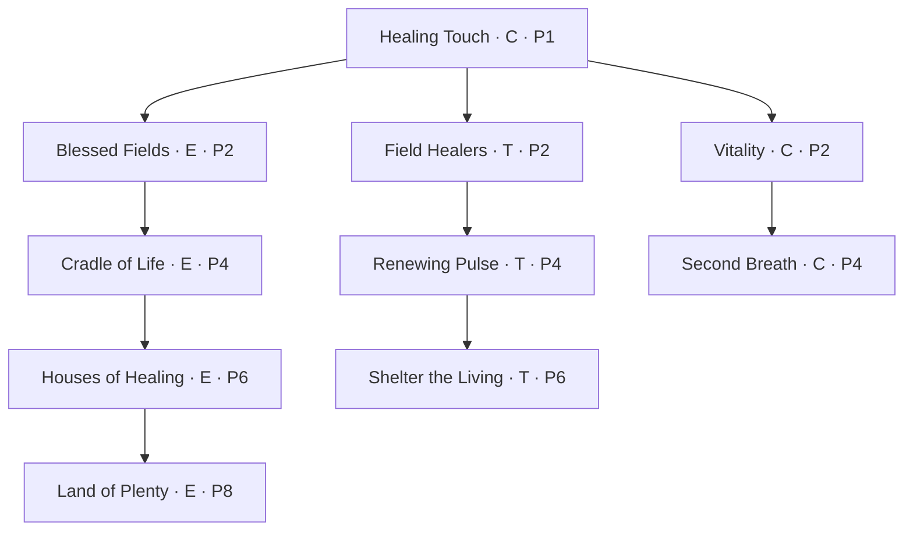
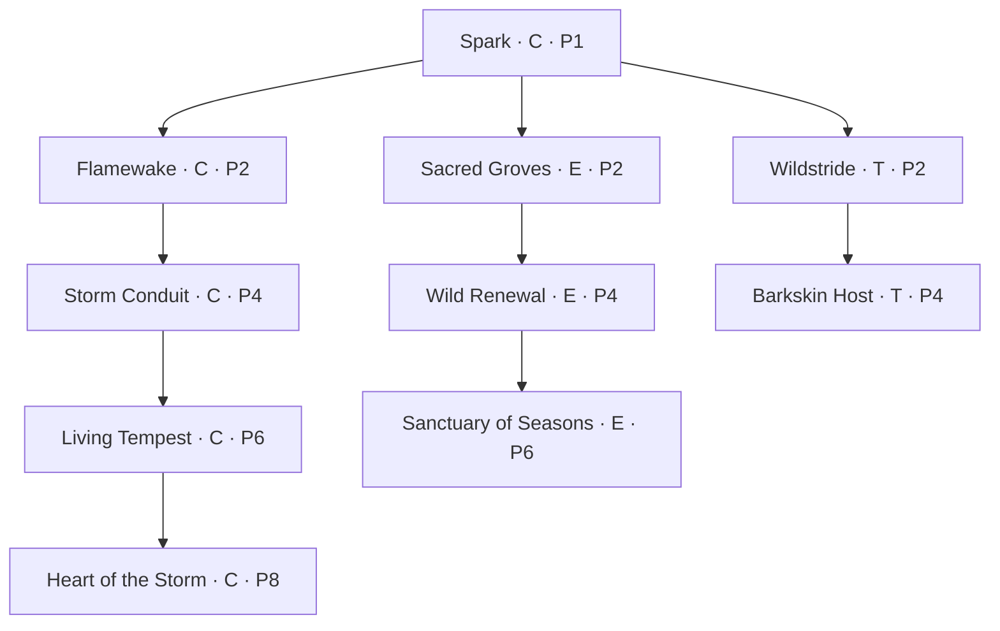
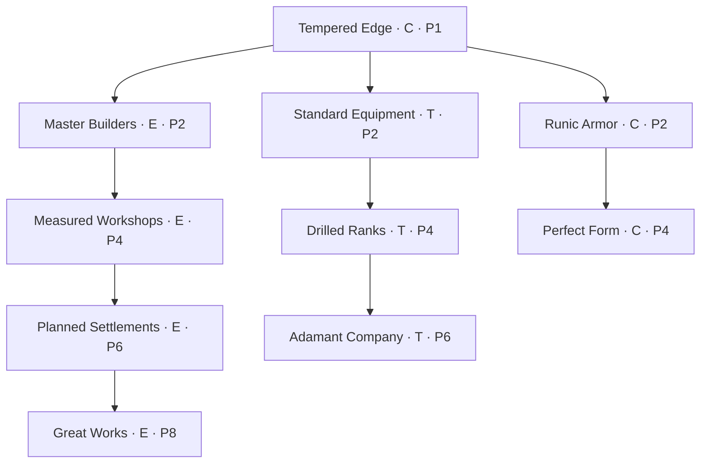
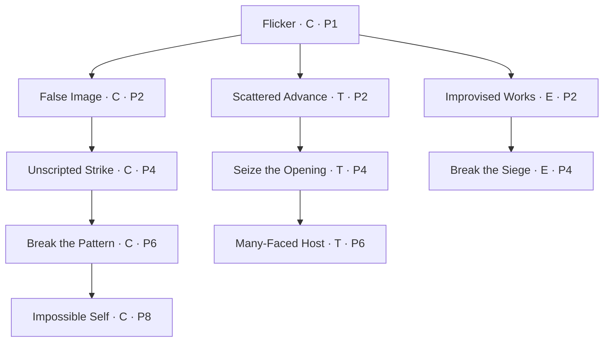

# Divine skill trees

**Design draft · 20 October 2026.** Seventy proposed nodes across the seven paths, based on [the divine-area descriptions](../Birthright.md#5-divine-powers) and [existing progression rules](DIVINE_POWER.md). Each tree has a shared root and three branches: character, troops and empire. Branch length and effects give each path its specialty. Numbers are starting balance targets, not measured results.

These are authored designs, **not newly implemented gameplay**. Only Sunburst, Lance, Divine rally and Mend currently have native catalog entries; even those still need Godot casting integration. Their IDs and prerequisite relationships are preserved here. Chaos's proposed identity is provisional.

## How the trees work

- **Divine power types are separate and non-interchangeable.** Strife nodes require Strife power, Harmony nodes require Harmony power, Death nodes require Death power, Life nodes require Life power, Nature nodes require Nature power, Order nodes require Order power, and Chaos nodes require Chaos power. There is no universal divine-power pool, conversion between types, or payment with another path's unused points.
- Each node costs **one ability point from its own path**, has one rank, and requires its immediate parent. Arrows mean prerequisites, not automatic unlocks. Sibling branches can be combined; there are no exclusive choices.
- The root requires **1 power of that tree's divine type**. The first, second, third and fourth nodes along each branch require **2, 4, 6 and 8 power of that same type**, respectively. Each tree contains ten nodes: a root, a four-node specialty, a three-node supporting branch and a two-node minor branch.
- Whole power of each type remains that type's independent allocation budget. At Strife power 4, choose the Strife root and three other eligible Strife nodes; at Strife power 8, its complete specialty costs five Strife points, leaving three for other Strife branches. All ten Strife nodes require Strife power 10. The same rule applies independently to each other type. This is a first progression tier, not a cap on divine power.
- For example, **Strife 8 / Life 1** supports eight Strife points and one Life point. It cannot unlock a Life-power-2 node or fund a second Life node, even with unused Strife points. Likewise, Life 4 / Nature 4 never satisfies a power-8 requirement in either tree. Respec returns allocation only to its original type.
- Character upgrades affect the inheritor. Troop upgrades affect their commanded warband, including detached members while still assigned to that band. They do not automatically affect every allied army. Empire upgrades affect directly governed holdings; only an explicitly realm-wide effect reaches vassal holdings, and only while the inheritor is sovereign.
- Active combat skills share the existing **four assignment slots across all paths**. Passives, triggered effects and campaign policies need no combat slot. The root still costs one point when granted by an origin.
- Keep existing free respec outside battle. It removes skill modifiers, not favor or ancestry. Learned skills are not inherited: heirs inherit power and allocate their own points. Losing power makes an over-budget path dormant under the current authority; none of its passive or empire benefits should remain active.
- A character can develop multiple paths, including opposed paths, by independently meeting each type's requirements. Combining their learned effects in a build does not combine their power or point budgets. No new opposition penalty, automatic favor income or change to inheritance or troop capacity is introduced by this proposal.

**Reading the diagrams:** C = character, T = troops, E = empire. P means power of the diagram's named divine type only: P4 in the Death tree requires Death power 4. Each branch begins at that type's power 2 and advances through 4, 6 and 8 where shown. The final node in each branch is its capstone, including the shorter branches.

## Shared balance vocabulary

Essence is only the proposed transient casting resource. It cannot substitute for any divine power type, unlock a node, or keep a node usable when its own type's power requirements are unmet.

An **active** entry lists proposed Essence cost / cooldown in combat seconds. Prototype casting assumes a separate transient 100-Essence pool with 5 Essence regenerated per second while alive; integration and equipment bonuses remain future work. Essence never spends favor. **D** is a provisional spell-damage baseline of 40 before mitigation; damage values below are multiples of D, independent of equipped weapon speed. A radius of one body length means approximately one standing human actor's height in world space; target-range values must be calibrated in the arena.

Unless specified, a single-target spell reaches eight body lengths and a group spell affects a radius of four around the caster. Same-named effects refresh rather than stack. Bonuses from different nodes add within the same stat; total skill damage reduction is capped at 40%, and total skill cost or duration reductions at 40%. Shields do not stack with themselves and absorb damage before health. Healing cannot exceed maximum health. Undead and blood constructs cannot receive Life healing; Harmony can still support their coordination or morale where they possess those systems.

Fear makes ordinary enemies retreat for the stated duration; bosses instead deal 10% less damage during that window. Enemy hard-control effects grant three seconds of immunity to that same control when they end. Summons cannot create more summons or yield favor, bodies, loot or demographic population. A corpse can be consumed once. Persistent encounters must record those facts through the campaign authority.

Campaign percentages modify the stated rate or cost, never create an immediate grant. Benefits apply prospectively at a daily tick; ordinary ownership, supply, labor and input requirements still apply. A skill cannot make food, money, labor or materials negative or bypass a blocked trade route. Higher growth remains limited by food and population capacity. Unrest uses a proposed normalized 0–100 design scale, to be converted to the core's units during implementation.

## Strife — the conquering champion

**Specialty: character. Secondary: troops. Minor: empire.** Win through personal aggression, spread fear, and turn a decisive attack into momentum. Its empire branch helps hold conquests rather than outproducing Order or nourishing populations like Life.

**Character — Champion**

- **Sunburst** (`strife_sunburst`, root; active, 20 / 12s): release a two-body-length shockwave for 0.75D damage and one body length of knockback. Divine force, rather than Nature's elemental fire.
- **Lance** (`strife_lance`; active, 20 / 8s): project a narrow lance through up to three enemies, dealing 1.25D to each. Preserve the existing requirement for Sunburst.
- **Blood Momentum** (`strife_blood_momentum`; passive): a successful melee hit grants +4% melee damage for five seconds, up to three stacks. At most one stack per attack, regardless of targets hit. All stacks expire together without another hit.
- **Dread Champion** (`strife_dread_champion`; triggered): an attack that reaches three Blood Momentum stacks fears nearby enemies for two seconds. Twenty-second internal cooldown; defeating a weak enemy is not required.
- **Avatar of Strife** (`strife_avatar`; active, 50 / 60s): for eight seconds, gain +25% melee damage, 15% damage reduction and immunity to fear. Blood Momentum remains separately capped at three stacks.

**Troops — Warhost**

- **Battle Cry** (`strife_battle_cry`; active, 25 / 25s): nearby troops gain +15% melee damage and +10% movement speed for six seconds.
- **Blooded Company** (`strife_blooded_company`; passive): troops gain +10% melee damage against enemies below half health.
- **Crimson Standard** (`strife_crimson_standard`; passive): Battle Cry reaches six body lengths and grants affected troops one charge for six seconds. Their next damaging hit consumes it to fear that target for one second; the immunity rule prevents chained fear.

**Empire — Conquest**

- **Iron Tribute** (`strife_iron_tribute`; policy): directly governed garrisons require 10% less cash upkeep. Food use and soldier headcounts remain unchanged.
- **Dread Dominion** (`strife_dread_dominion`; policy): newly conquered, directly governed holdings generate 25% less conquest-related unrest for their first 30 days under your rule. It does not reduce hunger grievances, erase existing unrest or reset on a change of governor within your realm.

## Harmony — strength through fellowship

**Specialty: troops. Secondary: empire. Minor: character.** Keep followers together and make cooperation durable. Harmony's protection and recovery are modest; Life remains the stronger healer.

**Root**

- **Divine Rally** (`harmony_rally`; active, 20 / 20s): remove fear from the hero and nearby troops and restore 15% of their maximum stamina. This restores readiness, not health.

**Troops — Fellowship**

- **Shared Resolve** (`harmony_shared_resolve`; passive): troops within two body lengths of another member of your warband suffer 25% shorter fear durations.
- **Shield Fellowship** (`harmony_shield_fellowship`; passive): those troops also take 8% less damage. The hero can count as a nearby companion but does not receive this reduction.
- **Practiced Together** (`harmony_practiced_together`; passive): troops who received the campaign's once-only training gain +10% stamina regeneration and +5% attack damage. It does not repeat the existing training health reward or favor award.
- **Unbroken Concord** (`harmony_unbroken_concord`; passive): Divine Rally additionally gives each affected unit a shield worth 15% of their maximum health for six seconds. Surrounded soldiers benefit without damage being transferred to other allies.

**Empire — Concord**

- **Trusted Steward** (`harmony_trusted_steward`; policy): funded public services reduce unrest 15% more effectively in directly governed holdings. No benefit when those services are unfunded.
- **Open Roads** (`harmony_open_roads`; policy): peaceful, open food-trade connections between your directly governed regions gain 10% throughput capacity. This raises the transport limit, not available food or household purchasing power.
- **Concord of Peoples** (`harmony_concord_of_peoples`; policy): while sovereign, reduce cultural-mismatch contributions to unrest and vassal loyalty penalties by 20% across your realm. It does not suppress differences in culture or cancel grievances from hunger and unpaid obligations.

**Character — Mediator**

- **Mend** (`harmony_mend`; active, 20 / 15s): heal yourself or one living ally for 15% of the target's maximum health over five seconds. Preserve its existing prerequisite, Divine Rally.
- **Peacemaker's Ward** (`harmony_peacemaker_ward`; triggered): successfully applying Mend to someone other than yourself gives you a 10%-maximum-health shield for five seconds. Fifteen-second internal cooldown; repeated applications do not stack shields.

## Death — the sovereign of the unquiet

**Specialty: troops. Secondary: character. Minor: empire.** Build expendable undead forces, sustain them with blood magic, and trade safety for power. Death gains labor and endurance rather than ordinary population growth.

**Root**

- **Grave Call** (`death_grave_call`; active, 25 / 15s): consume a nearby eligible fallen hostile's corpse to raise a skeleton for 30 seconds. Maximum two active; each has 50% of a baseline untrained troop's health and attack damage. Temporary undead count toward current troop capacity and require free capacity when raised; no permanent roster or inheritance identity is created.

**Troops — The Unquiet Host**

- **Bone Retinue** (`death_bone_retinue`; passive): increase the active raised-skeleton limit from two to four and duration from 30 to 45 seconds. The ordinary total troop-capacity limit still applies.
- **Deathless Discipline** (`death_deathless_discipline`; passive): your undead troops gain fear immunity and +10% movement speed. Living followers receive no immunity.
- **Ossuary Armor** (`death_ossuary_armor`; passive): undead troops take 15% less physical damage; Life magic still cannot heal them.
- **Legion of the Unquiet** (`death_legion_unquiet`; passive): Grave Call may consume up to three separate corpses per cast and the active skeleton limit becomes eight. Each undead troop that expires or dies restores 5% maximum health to one nearby surviving undead, once per summon. This cannot revive a unit or trigger another death effect.

**Character — Blood Magic**

- **Blood Price** (`death_blood_price`; active, 0 / 20s): pay 10% of your maximum health to recover 20 Essence. Casting requires strictly more health than the cost; shields cannot pay it. The payment is not damage and cannot trigger on-hit or on-damage effects.
- **Siphon Life** (`death_siphon_life`; active, 20 / 12s): deal 1D damage to a living hostile and heal for 40% of actual health damage dealt, capped at 10% of your maximum health. No healing from corpses, shields or your own summons.
- **Crimson Vessel** (`death_crimson_vessel`; active, 40 / 45s): pay 15% maximum health under Blood Price's payment rules to create a blood construct for 20 seconds. It has one baseline troop's health and damage, counts as undead, and requires one free troop-capacity slot. Only one construct may exist; it occupies one of the tree's active summon slots.

**Empire — Mortuary Stewardship**

- **Funerary Rites** (`death_funerary_rites`; policy): directly governed holdings generate 20% less unrest from recorded war casualties. This neither prevents deaths nor changes lineage release rules.
- **Silent Labor** (`death_silent_labor`; policy): a directly governed holding with a funded mortuary may assign up to 10% of its baseline civilian worker count as temporary undead construction labor, with one eligible local corpse per worker. It lasts seven days, costs upkeep equal to 50% of a normal worker's wage, consumes the corpse once, and only adds construction work. It creates no people, goods or reusable troop bodies and cannot displace paid civilian jobs.

## Life — a flourishing realm

**Specialty: empire. Secondary: troops. Minor: character.** Support people, food security and recovery. Life benefits from long-term care rather than instantaneous population creation or resurrection.

**Root**

- **Healing Touch** (`life_healing_touch`; active, 25 / 12s): immediately restore 25% maximum health to yourself or a living ally within two body lengths. Cannot target dead characters or reverse certified casualties.

**Empire — The Flourishing Realm**

- **Blessed Fields** (`life_blessed_fields`; policy): +10% food yield in directly governed holdings after labor, season and nutrition constraints. Inputs and spoilage still apply.
- **Cradle of Life** (`life_cradle_life`; policy): +10% to the ordinary cohort birth rate in directly governed holdings while nutrition meets normal needs and capacity is available. Does not force named births, alter adult ages or award favor.
- **Houses of Healing** (`life_houses_healing`; policy): funded health services reduce disease-related and malnutrition-related mortality rates by 15% in directly governed holdings. Does not affect battle deaths, old age or irreversible death records; disease awaits its own system.
- **Land of Plenty** (`life_land_plenty`; policy): while sovereign, realm food-storage spoilage rates fall by 25% and nutrition recovery rates improve by 15% where food needs are actually met. Neither effect generates food or makes starving regions well-fed.

**Troops — Preservation**

- **Field Healers** (`life_field_healers`; passive): tending your living troops restores 20% more of whatever health the tending action would normally restore. No additional training bonus or favor; requires the future persistent injury/tending integration.
- **Renewing Pulse** (`life_renewing_pulse`; active, 35 / 25s): living troops and the hero in range recover 2% of maximum health per second for six seconds. Refreshing the effect does not multiply its rate.
- **Shelter the Living** (`life_shelter_living`; triggered): the first time each living troop falls below 25% health during an encounter, it gains 25% damage reduction for four seconds. This does not prevent a lethal blow or grant resurrection.

**Character — Vitality**

- **Vitality** (`life_vitality`; passive): +15% maximum health. Learning or reactivating it preserves health percentage and cannot heal by repeated respec.
- **Second Breath** (`life_second_breath`; triggered): once per encounter, surviving damage that leaves you below 30% health starts regeneration totaling 20% maximum health over five seconds. Cannot trigger after death or from health payments.

## Nature — the storm and the wild

**Specialty: character. Secondary: empire. Minor: troops.** Elemental destruction, difficult terrain and restored wilderness. Nature keeps lightning and fire; Chaos does not take over its elemental identity.

**Root**

- **Spark** (`nature_spark`; active, 15 / 6s): strike one enemy with lightning for 1D damage.

**Character — Elemental Sovereignty**

- **Flamewake** (`nature_flamewake`; active, 25 / 16s): create a fire patch at a point within six body lengths. Its two-body-length radius deals 0.25D per second to enemies for five seconds. Only one patch per caster; reapplying replaces it.
- **Storm Conduit** (`nature_storm_conduit`; passive): Spark chains to up to two additional distinct enemies within two body lengths of the previous target, dealing 50% of its original damage to each. No repeat targets per cast.
- **Living Tempest** (`nature_living_tempest`; passive): landing Spark gives +10% movement speed for three seconds and reduces Flamewake's remaining cooldown by two seconds. Six-second internal cooldown, once per cast regardless of chain targets.
- **Heart of the Storm** (`nature_heart_storm`; active, 50 / 60s): for eight seconds, a moving three-body-length storm around you strikes up to three distinct nearby enemies once per second for 0.25D each. You gain 20% elemental damage reduction for its duration.

**Empire — The Sacred Wild**

- **Sacred Groves** (`nature_sacred_groves`; policy): maintained shrines in directly governed wilderness holdings reduce local unrest generation by 10%. Shrine upkeep remains required; this does not grant passive favor.
- **Wild Renewal** (`nature_wild_renewal`; policy): funded wilderness-restoration projects take 20% less time. They retain their material and land-use costs; restoring wilderness can reduce land available for construction.
- **Sanctuary of Seasons** (`nature_sanctuary_seasons`; policy): directly governed holdings adjacent by land to maintained sacred wilderness suffer 25% smaller negative seasonal food-production modifiers. Positive seasons are unchanged; multiple adjacent groves do not stack.

**Troops — Wardens**

- **Wildstride** (`nature_wildstride`; passive): reduce your warband's forest and marsh travel-cost penalties by 25%. It reduces only the extra terrain penalty, never the route's base cost or distance.
- **Barkskin Host** (`nature_barkskin_host`; active, 25 / 25s): nearby troops gain 15% physical damage reduction for six seconds. The hero receives no benefit from this troop ward.

## Order — the realm made enduring

**Specialty: empire. Secondary: troops. Minor: character.** Turn investment, craftsmanship and preparation into lasting strength. Order improves structures and equipment; Harmony improves cooperation between people.

**Root**

- **Tempered Edge** (`order_tempered_edge`; active, 15 / 20s): your equipped weapon deals 15% more basic-attack damage for eight seconds. It does not multiply divine spell damage.

**Empire — The Masterwork Realm**

- **Master Builders** (`order_master_builders`; policy): construction in directly governed holdings requires 15% fewer work-days. Material costs stay unchanged.
- **Measured Workshops** (`order_measured_workshops`; policy): tools and luxuries recipes in directly governed holdings consume 10% fewer materials. Other inputs, labor, output demand and inventory limits still constrain production.
- **Planned Settlements** (`order_planned_settlements`; policy): completed housing and storage projects in directly governed holdings provide 15% more of their respective capacity while this skill is active. Losing the bonus pauses new occupancy or deposits until below capacity; it never deletes people or stored goods.
- **Great Works** (`order_great_works`; policy): designate one funded capital project across your realm. It gains another 20% reduction in required work-days and, while sovereign with this node active, the realm's completed fortifications take 15% less siege damage. The project's original requirements remain fixed for accounting; progress is earned at the modified rate, not granted by toggling the skill.

**Troops — The Equipped Host**

- **Standard Equipment** (`order_standard_equipment`; passive): equipped troops gain +8% weapon damage. Unarmed followers and summoned creatures receive no benefit.
- **Drilled Ranks** (`order_drilled_ranks`; passive): equipped troops spend 15% less stamina when blocking. Their normal block arcs and timing remain required.
- **Adamant Company** (`order_adamant_company`; passive): armored troops take 10% less physical damage and recover from knockdown 25% faster. Neither grants immunity or affects the hero.

**Character — The Living Masterwork**

- **Runic Armor** (`order_runic_armor`; passive): wearing equipped armor grants 10% physical damage reduction. Cosmetic equipment alone does not qualify.
- **Perfect Form** (`order_perfect_form`; triggered): a successful timed block makes your next basic weapon attack within four seconds deal 25% more damage and cost 25% less stamina. Eight-second internal cooldown; one charge only. Requires an authored timed-block window.

## Chaos — the breaker of certainty

**Provisional identity: change, deception and disruption. Specialty: character. Secondary: troops. Minor: empire.** This is a proposal for the undefined seventh path, not established lore. Its skills create openings and let an underdog adapt, with deterministic effects instead of random catastrophic outcomes.

**Root**

- **Flicker** (`chaos_flicker`; active, 20 / 10s): teleport up to three body lengths to a visible, walkable point. Cannot cross sealed barriers, leave the encounter bounds or confer invulnerability after arrival.

**Character — The Unbound**

- **False Image** (`chaos_false_image`; passive): Flicker leaves a three-second decoy at its departure point. It can divert ordinary AI targeting until hit once, deals no damage and cannot force bosses or players to retarget. One decoy maximum.
- **Unscripted Strike** (`chaos_unscripted_strike`; passive): your first damaging weapon hit within three seconds of Flicker gains +20% damage. One charge per cast; an area attack spends it on the first valid target only.
- **Break the Pattern** (`chaos_break_pattern`; triggered): a successful dodge of an attack reduces Flicker's remaining cooldown by three seconds. Six-second internal cooldown, once per dodge even against several attacks.
- **Impossible Self** (`chaos_impossible_self`; active, 40 / 40s): swap places with your existing visible decoy within six body lengths and consume it. Clear movement slows and roots, but not knockdown, stun or damage over time. Both positions must still be legal; cannot cast while actions are disabled.

**Troops — The Irregular Host**

- **Scattered Advance** (`chaos_scattered_advance`; passive): troops with no other member of your warband within two body lengths gain 10% movement speed and take 10% less ranged damage. This rewards spacing, unlike Harmony's close support.
- **Seize the Opening** (`chaos_seize_opening`; passive): troops deal 12% more damage to enemies currently attacking or pursuing one of your decoys. No bonus merely for having a decoy somewhere on the battlefield.
- **Many-Faced Host** (`chaos_many_faced_host`; active, 35 / 35s): create decoys beside up to four nearby troops for four seconds. Each breaks on one hit and deals no damage; a new cast replaces previous troop decoys. They are not real troops, cannot occupy strategic positions or grant kill rewards, and cannot be used by Impossible Self.

**Empire — Adaptation**

- **Improvised Works** (`chaos_improvised_works`; policy): rebuilding damaged structures in directly governed holdings uses 15% fewer materials. New construction gains no reduction; deliberate demolition yields no refund or eligible damage.
- **Break the Siege** (`chaos_break_siege`; campaign action): once per region per 30 campaign days, attempt an emergency supply passage to a directly governed besieged holding from a connected, willing friendly supplier. Pay twice the normal transport cash cost to move at most three days of its civilian food need through one blockade edge. Real source stock and an otherwise valid land route are required; it cannot cross water or create food. Cooldown and delivery receipts survive respec, ownership changes and save/load.

## Example allocations

These show meaningful choices within the existing per-path budget; they do not award extra points.

- **Strife 8, champion with followers:** Sunburst, all four Champion nodes, Battle Cry, Blooded Company and Iron Tribute. Eight points; a full personal branch, two troop upgrades and one holding benefit. Equip Sunburst, Lance, Battle Cry and Avatar of Strife in the four combat slots.
- **Harmony 8, army and realm:** Divine Rally, all four Fellowship nodes, Trusted Steward, Open Roads and Concord of Peoples. Eight points; forego the personal healing branch for better troops and governance. Only Rally needs a combat slot.
- **Order 8, builder-general:** Tempered Edge, all four Masterwork Realm nodes, Standard Equipment, Drilled Ranks and Runic Armor. Eight points; economy, army preparation and personal defense.
- **Mixed Life 4 / Nature 4:** Life buys Healing Touch, Blessed Fields, Field Healers and Renewing Pulse. Nature buys Spark, Flamewake, Storm Conduit and Wildstride. Each path spends four points independently. Equip Healing Touch, Renewing Pulse, Spark and Flamewake; the remaining skills are always-on while eligible.

## Implementation boundaries and next steps

This document supplies a design catalog, not a parallel progression authority. Extend the native `DivineNodeDefinition` and `World` command/build path to distinguish active abilities, passives, triggered effects and campaign policies before making these learnable. Preserve the four existing IDs, their one-point costs, power requirements and parent links. Version expanded content deliberately; do not relabel these proposed mechanics as already supported by source ability IDs such as `Burst` or `Mend`.

Runtime work includes a tree interface, derived modifiers, ownership scopes, a separate transient casting resource, spell execution, summon accounting and persistent effect/cooldown receipts. Morale/fear, timed blocks, persistent injuries, necromancy, health services, shrines, restoration, fortifications and player sieges need supporting systems; related nodes should remain visibly unavailable until those integrations exist. Strategic battle resolution needs its own adapters rather than assuming actor-level skills automatically affect abstract armies.

At daily campaign boundaries, resolve the current living officeholder and each holding's governing authority. Apply only the strongest instance of the same named policy to a holding, never an additional copy per vassal or ancestor. Sovereign and local policies with different IDs can coexist within the stated caps. Loss of office, death, dormancy or respec removes prospective benefits without deleting completed buildings or rewriting past receipts.

Respec must not restore combat health, Essence, cooldowns, corpse availability or once-per-encounter triggers. Capacity bonuses preserve overflow rather than destroying stock; future production is blocked until it fits. Construction and births already completed remain real, while ongoing rates return to their unmodified values. Campaign actions keep their cooldown and consumption records independently of learned nodes. These safeguards are proposed requirements for integration, not claims about the current four-node prototype.

Initial playtests should compare solo survivability, an equal-size equipped warband and 90 campaign days of equal starting holdings. Check both branch-focused and mixed builds. Test whether Strife wins short melee fights, Harmony preserves formations, Death replenishes expendable units, Life recovers from hardship, Nature excels against clustered enemies and harsh terrain, Order rewards investment, and Chaos creates tactical openings without replacing those specialties.
